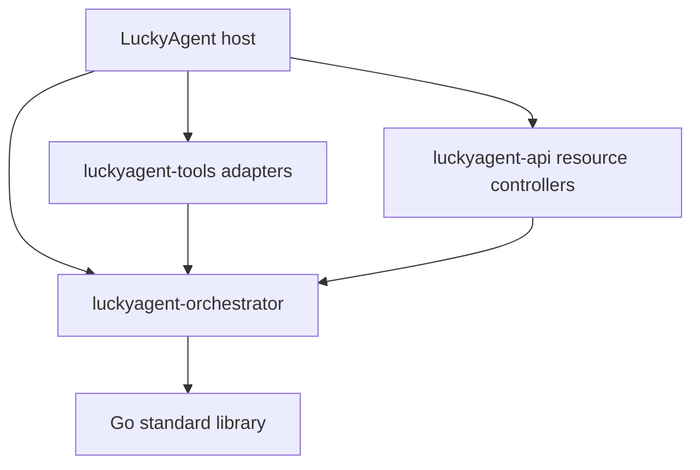

# Scheduling module boundaries

## Dependency direction



The host injects execution callbacks into the engines. Those callbacks can
invoke the host's Agent Loop without adding an import from this module to the
host. Provider selection, context construction, tool execution, approval,
session persistence, durable-loop reasoning and platform notifications remain
host-owned.

## Three execution paths

1. Ordinary chat delegation: tool SDK `subagent` adapter -> `delegate` manager
   -> injected agent executor -> host Agent Loop. Tool schemas, permission
   metadata, request fingerprinting and `ExecutionContext` adaptation stay in
   the SDK. The SDK's manager facade embeds the independent manager.
2. HTTP collaboration: API resource controller -> `collab` manager -> injected
   `TaskHandler` -> the host's session-aware chat execution. The collaboration
   engine owns pipeline, parallel and debate execution and Planner feedback.
3. Background autonomy: SDK `autonomy action=add` -> persistent `TaskQueue` ->
   worker dispatcher -> `AgentExecutor.RunLoopWithSession` -> host Agent Loop.
   The host enables queue persistence, provisions sessions and owns lifecycle.

`autonomy.heartbeat.mode` controls heartbeat behavior. `proactive` can dispatch
queued work in addition to checking blocked tasks. `passive` does not disable
the worker pool's separate dispatcher.

Ordinary delegation dispatches `parallel`, `pipeline` and `debate` through
`collab`, with distinct execution sessions and an injected semantic assignment
planner. `autonomy_queue` calls an injected durable-queue adapter and fails if
none is configured. The application owns that queue and its worker lifecycle.
Pending/running admission is atomic and idempotent; adapters share execution
slots through `WithExecutionSlot`.

Assignments include explicit responsibilities and acceptance criteria. Required
verification fails closed without a verifier and finishes before durable child
completion. Failed assignments make the parent fail while retaining useful
partial results; retries include prior feedback. Ballots preserve positions,
reject unknown agents and require a strict majority. Aggregation preserves
unscored candidates and never infers consensus from a shared text prefix.

## Durable state and foreground use

- `task.Record` and its artifacts retain their existing JSON fields and files.
- `autonomy.QueueTask` retains the queue snapshot format, task session IDs,
  checkpoints, operation records, acceptance criteria, retries and budgets.
- These are separate models. Repository extraction does not merge their
  state machines or replace one store with the other.
- Startup `SetTaskStore` restores direct delegate/collaboration history and
  marks interrupted direct work failed, preserving task/session links. It
  returns recovery errors and must run before serving requests. It never
  replays side effects. Private new-run managers use `AttachTaskStore` without
  reconciling another manager's active tasks. `Wait` includes persistence and
  planner feedback; direct task history is separate from queue recovery.
- LuckyAgent also uses `autonomy.TaskQueue`/`Execution` for foreground durable
  turns. Its foreground files are separate from the background queue and are
  driven directly by the foreground loop. Background workers must not poll
  those files.
- The host's adapter between `autonomy.Execution` and its durable-turn
  contract remains in the host. This module does not import `internal/turn`.

The private atomic-file helper preserves the queue's previous write, fsync,
rename and directory-sync behavior without depending on tool SDK utilities.

Queue snapshots use compact JSON with the same version-1 fields. Readers accept
both legacy indented snapshots and compact snapshots. This removes whitespace
expansion under the queue lock; it does not change the full-snapshot complexity
or replay ambiguous operations. `BenchmarkQueueSnapshotEncoding` compares both
encodings at 100/1000 operations per task, and `BenchmarkQueuePersistLock`
measures the actual atomic-save lock occupancy and output bytes for four tasks.
Run these synthetic benchmarks with `go test ./autonomy -run '^$' -bench
'BenchmarkQueue(SnapshotEncoding|PersistLock)' -benchtime=30x`. They are not
production latency or task-quality measurements.

## Compatibility

The tool SDK retains `autonomy`, `collab` and `task` forwarding packages with
type/constant/function aliases. There is a single engine implementation here.
Existing SDK root names such as `DelegateConfig` and `DelegateTask` remain
aliases; the root `DelegateManager` facade keeps its tool factory methods.
Tool names, parameter defaults, permission levels and response JSON are
preserved. The host and API now import this module's engine packages directly.

No configuration schema or example values change. LuckyAgent continues to
map its existing `autonomy.*` and `delegate.*` settings to engine options and
to choose runtime home paths itself.

## Local development and release order

For joint development, initialize an ignored workspace in each consumer that
needs local sources, adjusting paths as necessary:

```bash
go work init . /path/to/luckyagent-orchestrator
go build ./...
```

For host/API joint development, add the matching tools, API and gateway
checkouts to that workspace as appropriate. Workspace files are local and are
not committed; consumer `go.mod` files contain no local filesystem replacement.

Publish the orchestrator first, then tools, API, and finally the host's pinned
dependency versions. The initial orchestrator version is `v0.1.0`. Consumer
release builds use downloadable versions with `GOWORK=off`; workspace files
are only needed when developing against local changes.
